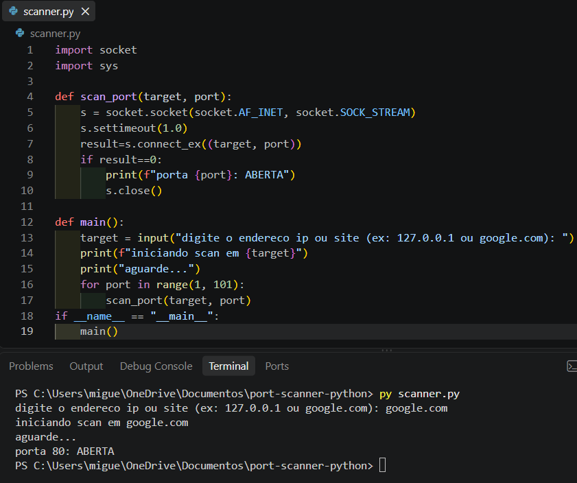

# 🛡️ Cyber Port Scanner em Python

## 📖 Visão Geral
Este é um script de auditoria de rede desenvolvido em Python. Ele resolve o problema de identificar rapidamente quais portas TCP estão abertas em um determinado host (IP ou domínio), sendo uma ferramenta útil para os primeiros passos em testes de segurança e reconhecimento de infraestrutura.

## 🛠 Tecnologias Utilizadas
- **Python 3** (Linguagem principal)
- **Biblioteca Socket** (Comunicação de rede nativa)

## ⚙️ Como Executar o Projeto

1. Clone o repositório:
```bash
git clone https://github.com/miguelmoret81-create/cyber-port-scanner.git
```
2. Navegue até a pasta do projeto:

```bash
cd cyber-port-scanner
```
3. Execute o script:

```bash
python scanner.py
```
4. Digite o alvo quando solicitado (ex: 127.0.0.1 ou google.com).

📸 Demonstração Visual

